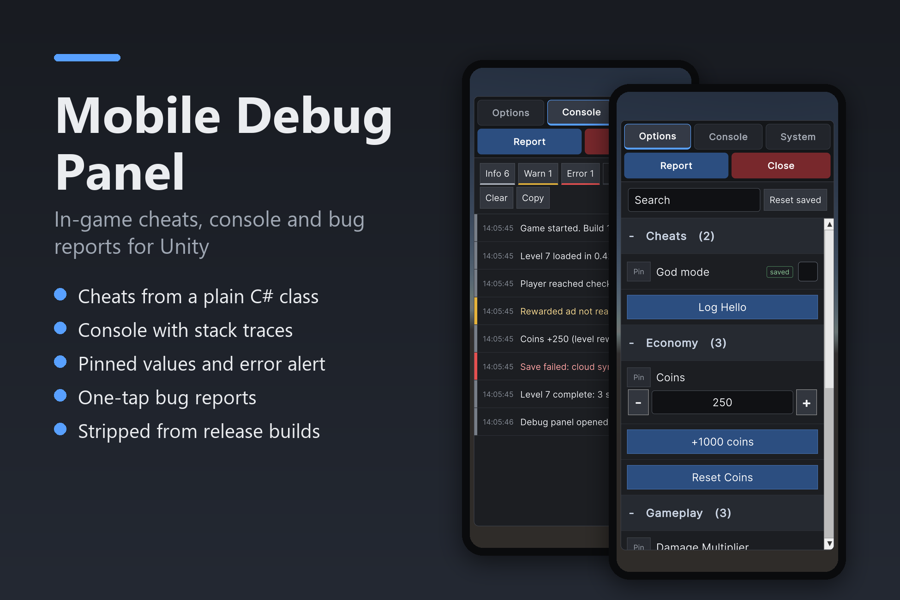
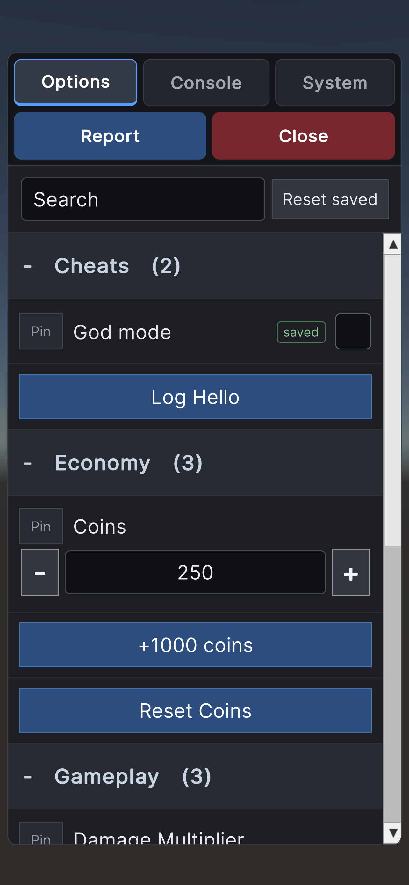
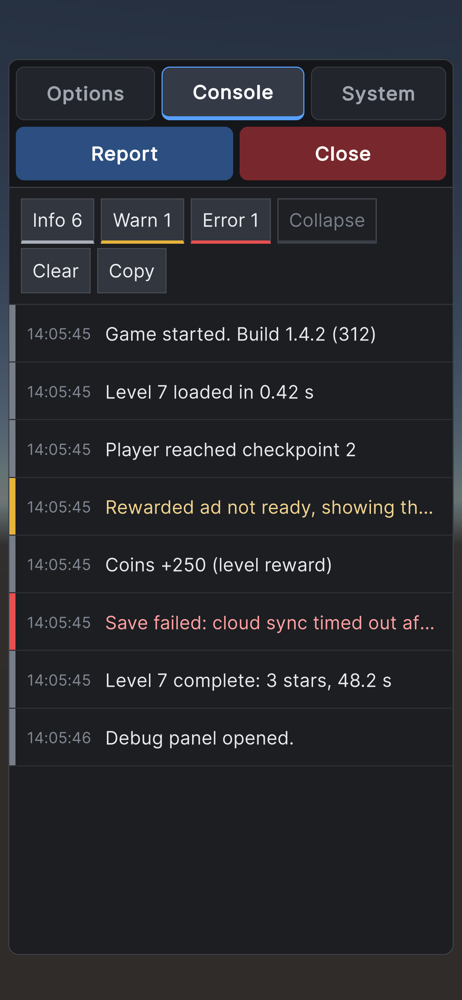
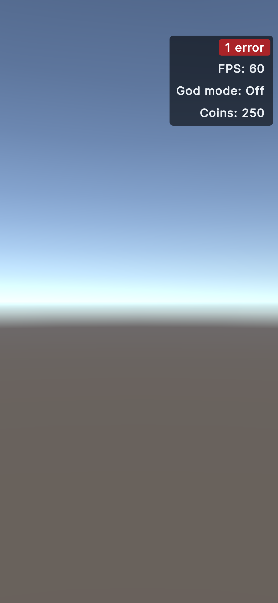
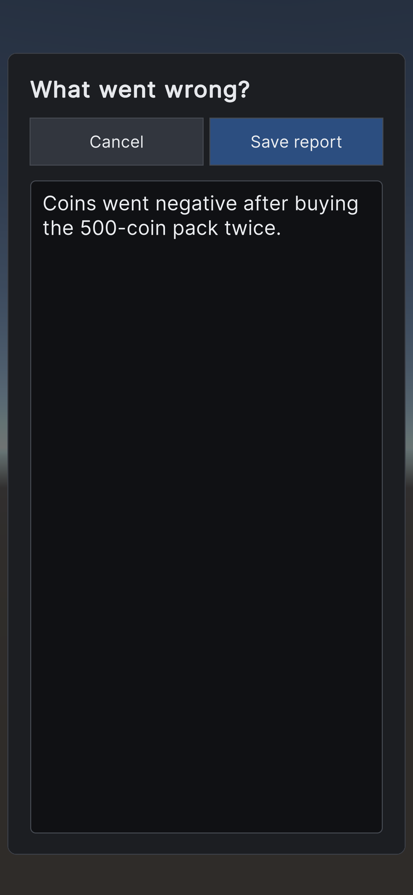
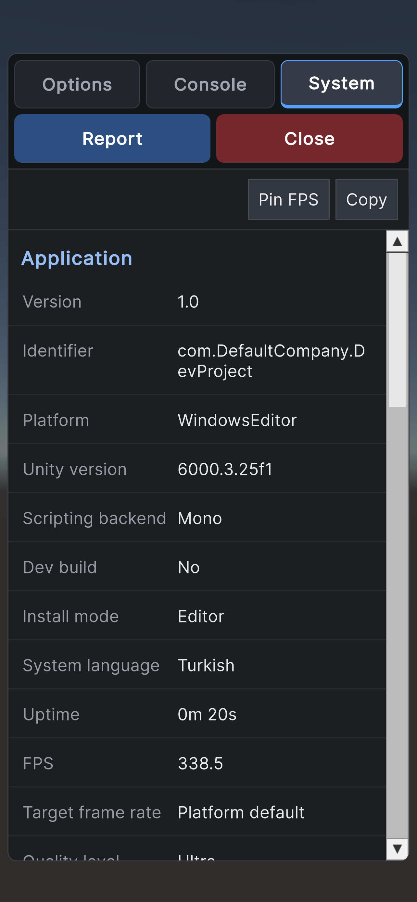

**Mobile Debug Panel** turns a plain C# class into an in-game cheat menu for Unity, with a log
console, device info, pinned values and one-tap bug reports. It is on in the Editor and in
development builds, and stripped from release builds.

[Documentation](docs.md) · [Changelog](changelog.md) · [Asset Store](https://assetstore.unity.com/packages/slug/426824) · [Support](#support)

<video src="assets/MobileDebugPanel.mp4" controls muted playsinline style="width:100%;border-radius:8px"></video>

## What it does

- **Cheats from a plain C# class.** Register an object with one line; its public members become
  toggles, number fields, dropdowns, text fields and buttons. Attributes set the category, label,
  order, range and step, and `[Persist]` keeps values across restarts.
- **Console** with every log message from start-up, filters, collapsing and stack traces.
- **Error alert** while the panel is closed, so failures on a test device are noticed.
- **System** facts with live FPS, one tap to copy.
- **Pinned values** in a small box that stays on screen while you play.
- **Bug reports:** a screenshot without the panel plus a text report with every value and the log.
- **Safe for release builds:** none of its code or assets ship unless you turn it on, and code that
  calls it still compiles.
- **Built for phones:** UI Toolkit, safe area aware, same physical size on every phone.

Unity 6.3 LTS or later. Android, iOS, Windows, macOS and the Editor; IL2CPP and Mono. Full source
code included.

## Screenshots

<figure style="display:inline-block;width:30%;min-width:180px;margin:0 1% 16px;vertical-align:top"><figcaption style="font-size:14px;color:#57606a">Options: cheats from a plain C# class</figcaption></figure>
<figure style="display:inline-block;width:30%;min-width:180px;margin:0 1% 16px;vertical-align:top"><figcaption style="font-size:14px;color:#57606a">Console with filters and stack traces</figcaption></figure>
<figure style="display:inline-block;width:30%;min-width:180px;margin:0 1% 16px;vertical-align:top"><figcaption style="font-size:14px;color:#57606a">Pinned values and the error alert while playing</figcaption></figure>
<figure style="display:inline-block;width:30%;min-width:180px;margin:0 1% 16px;vertical-align:top"><figcaption style="font-size:14px;color:#57606a">One-tap bug reports</figcaption></figure>
<figure style="display:inline-block;width:30%;min-width:180px;margin:0 1% 16px;vertical-align:top"><figcaption style="font-size:14px;color:#57606a">Device facts and live FPS</figcaption></figure>

## Support

Questions, bugs or requests: **[ttosun350@gmail.com](mailto:ttosun350@gmail.com)**. Please include your Unity version, the
platform, and if you can a bug report from the panel itself (the *Report* button saves one).
